# REDI Lab / VIRTUTES

**An adaptive AI software factory.** REDI Lab treats software delivery like a
production line: fixed, governed **stations** do the work, and the AI models
that staff them are **replaceable workers**. Every step passes explicit quality
gates and leaves evidence that can be replayed and audited later.

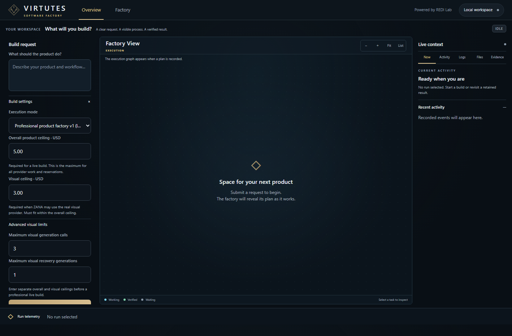

## See it work

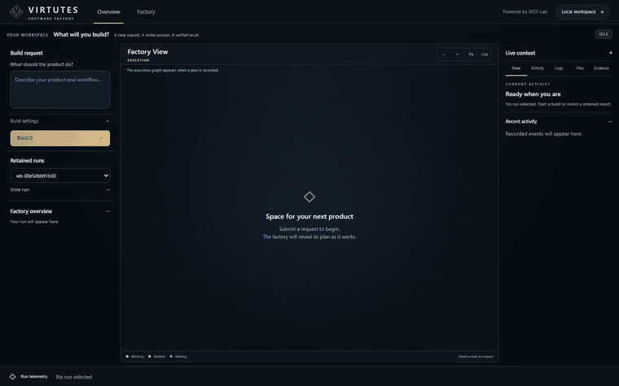

This recording ([MP4](docs/media/workshop-live-app-ready.mp4), sped up) is a **real-provider build from
scratch**. One request for a car-repair **Workshop Job Tracker** went in, and a verified, runnable app came
out. The build took 7 model calls, about 40k tokens and **USD 0.16**, with visuals off.

1. **Ora** planned the product and paused once for an owner decision on points the brief left open.
2. **Andinus** (data) and **Bindus** (workflow) built in parallel, then **Agron** (business logic),
   **Teuta** (UI) and **Gentius** (assembly). All six frozen gates passed.
3. **Medaurus**, the independent reviewer, left two prose criteria without an observable check. The owner
   authorized a provider-free evaluator repair on the same run, and the review then passed **52/52**
   real browser observations, including "jobs cannot move backward" and "phone numbers need not be unique".
4. The app was opened and used with real data: customers, vehicles and repair jobs moved
   new → in progress → done. The dashboard shows 2 open jobs and EUR 185.00 revenue from done jobs.

| Personas working in parallel | APP READY: every station verified |
| --- | --- |
| 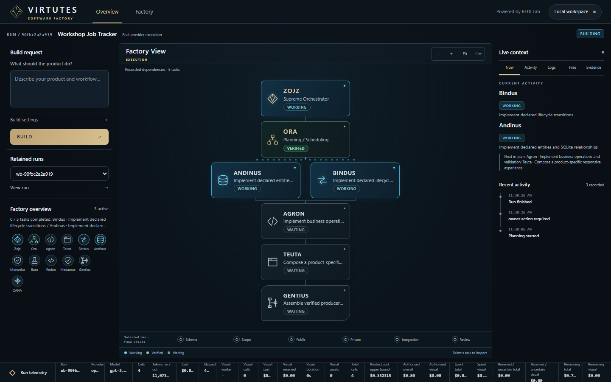 | 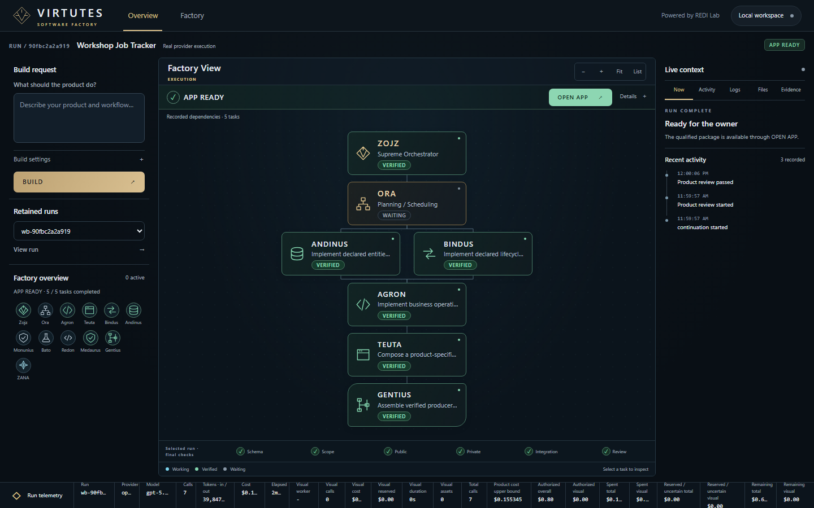 |
| **Generated app: repair-job board** | **Generated app: dashboard** |
| 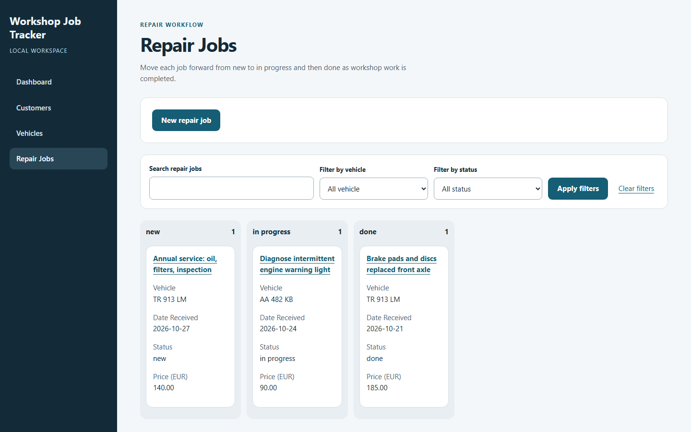 | 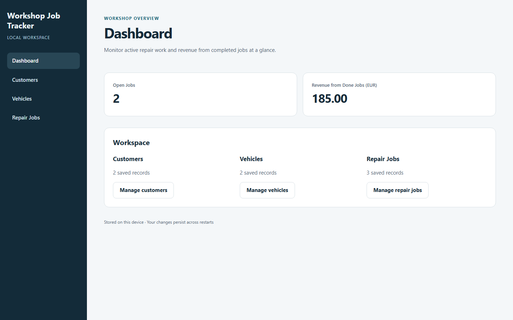 |
| **Evidence and instrumentation** | **Generated app on mobile** |
| 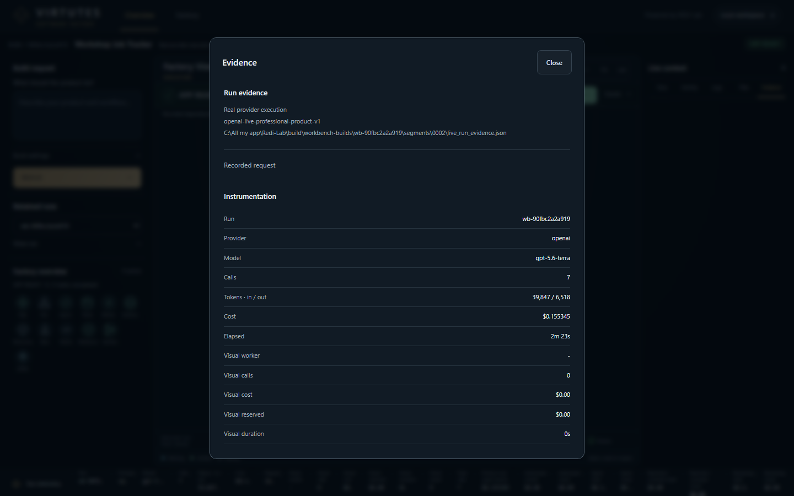 | 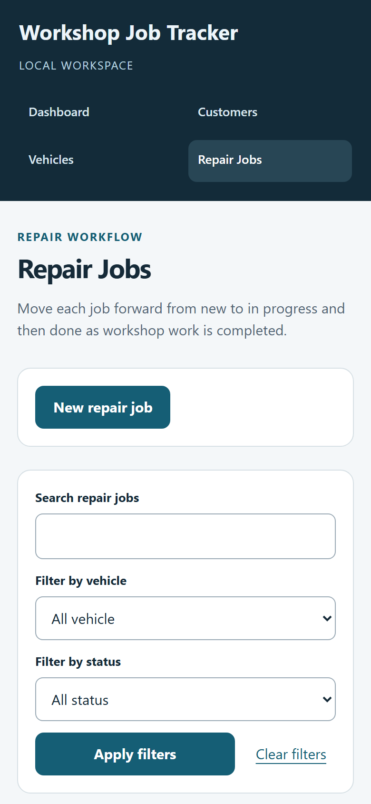 |

### Another example: ILIRIA

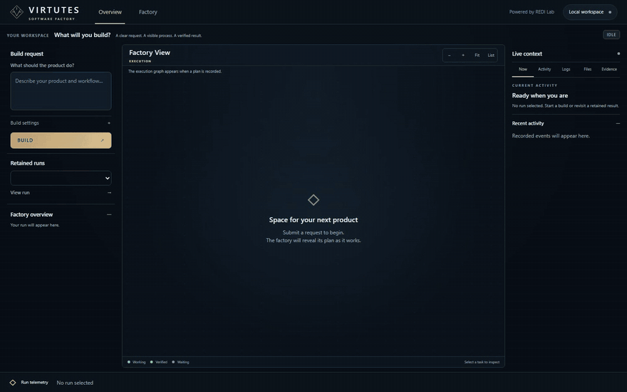

The [ILIRIA demo](docs/media/virtutes-demo.mp4) replays a retained real-provider build, a creative
production board built in 6 model calls for USD 0.15. It then creates real records in the generated app,
which enforces its own workflow: new videos must start in *Idea* and move forward stage by stage.

| Factory view | The generated app with real records |
| --- | --- |
| 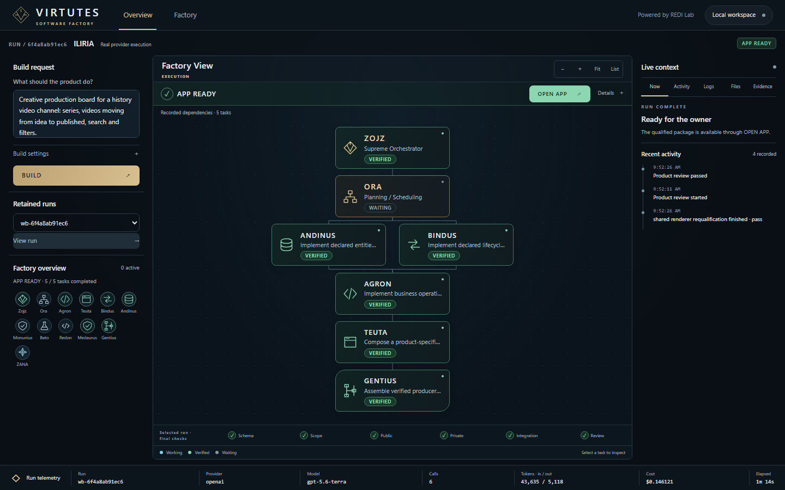 | 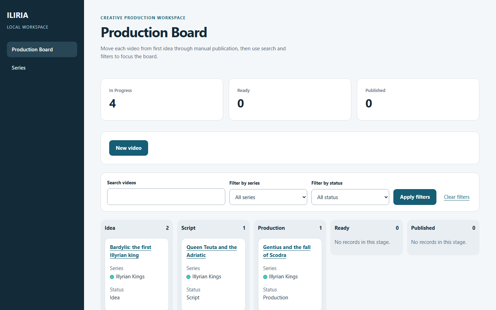 |

### Governance in action

Getting the workshop app to APP READY took seven live runs (USD 1.34 in total under a USD 2.00 owner
budget). The earlier runs stopped honestly instead of shipping:

- **Paused for the owner.** Ora stopped planning whenever the brief left something open. Each answer
  becomes a new append-only, hash-chained segment of the same run, and there can be any number of them.
  One run went through four owner decisions in a row.
- **Live graph.** The factory graph and crew update from the running worker, also inside a resumed segment.
- **Refused to fake a pass.** When a real-browser check failed, the line tried a same-station correction
  and then a stronger worker, and finally stopped with the exact failed assertion as evidence.

Those stops exposed defects in the factory's own checks, and each is fixed with tests:
- Empty boards rendered no workflow columns.
- Prohibitions such as "cannot move backward" were read as required reverse moves.
- Summaries were expected where the renderer never places them.
- Several prose criteria had no observable check.
- Windows line endings made an unchanged runtime look modified.

| Third owner decision in one run | Stopped with exact evidence |
| --- | --- |
| 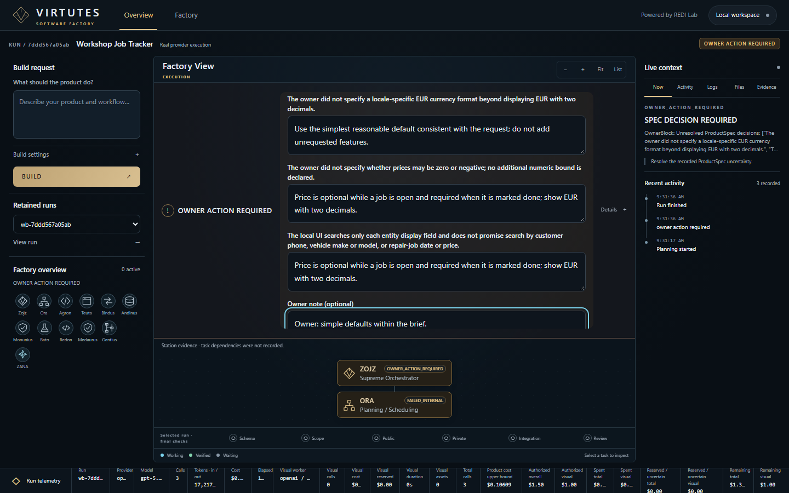 | 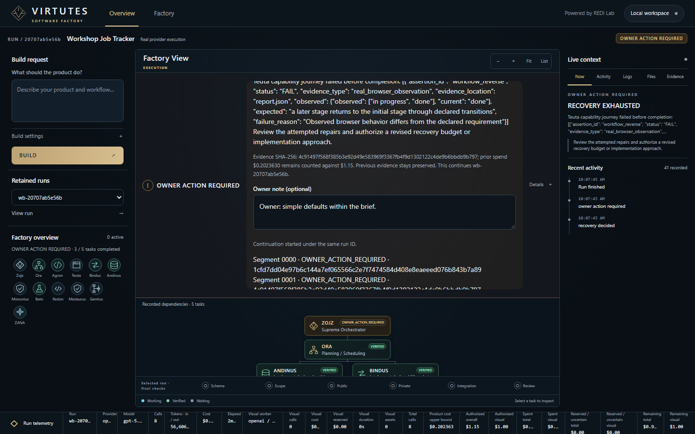 |

## Core ideas

- **Stations vs. workers.** A station (spec, build, test, review, visual…)
  defines the contract: inputs, outputs, gates and budget. The worker filling
  it (a model or a deterministic fake) can be swapped without changing the line.
- **Quality gates.** Each hand-off is checked against typed domain contracts
  before the next station may start. Failures stop the line with a recorded
  reason instead of drifting silently.
- **Evidence ledger and replay.** Calls, prompts, outputs, costs and verdicts
  are hashed into an append-only ledger, so a run can be replayed and its
  provenance reconciled.
- **Recipes.** Successful line configurations are stored as recipes and reused
  for warm starts on new work.
- **Minimum Capable Worker (MCW) experiments.** Paired and hold-out experiments
  measure the cheapest worker that still passes a station's gates, under an
  explicit cost ceiling.
- **Governed recovery.** Bounded same-run recovery and correction loops, with
  build budgets and runtime freshness checks.

## VIRTUTES Workbench

A local, dependency-free web Workbench shows the factory as a live task graph.
The crew is presented as personas: **Zojz** and **Ora** (orchestration),
**Agron**, **Teuta**, **Andinus**, **Bindus**, **Redon**, **Bato**,
**Monunius**, **Medaurus**, **Gentius** and **ZANA** (visual station). It works
on desktop and mobile, with budget controls, per-task telemetry and an
"open app" result view.

## Proven results

- A **Workshop Job Tracker** built live from scratch to APP READY (USD 0.16), plus a **Mini CRM** built end to end.
- A **multi-station parallel live run** across a dependency DAG.
- **976 tests**, passing on Windows and Linux without extra settings.
- **Zero runtime dependencies**: Python standard library only (Python 3.11+).

## Getting started

```bash
pip install -e .[dev]
pytest
```

Start the Workbench (offline by default, using deterministic fake workers):

```bash
python -m redi_lab.workbench.server --port 8765
# then open http://127.0.0.1:8765/
```

### Live provider calls

Nothing contacts a model provider unless you arm it explicitly. Live runs need:

- your own key in `REDI_OPENAI_API_KEY`
- `REDI_LIVE_PROVIDER=1`
- the `--live` flag on the relevant script, plus its cost ceiling

No keys are included in this repository.

## Repository layout

| Path | Contents |
| --- | --- |
| `redi_lab/` | Domain contracts, factory line, gates, evidence ledger, replay, recipes, experiments, Workbench |
| `tests/` | Unit and integration tests (offline) |
| `scripts/` | Validation and experiment runners |
| `docs/` | Architecture, research charter, threat model, data policy, station designs |
| `experiments/` | Experiment bindings and fixtures |

## License

Source-available for reading and evaluation only. See [LICENSE](LICENSE).
