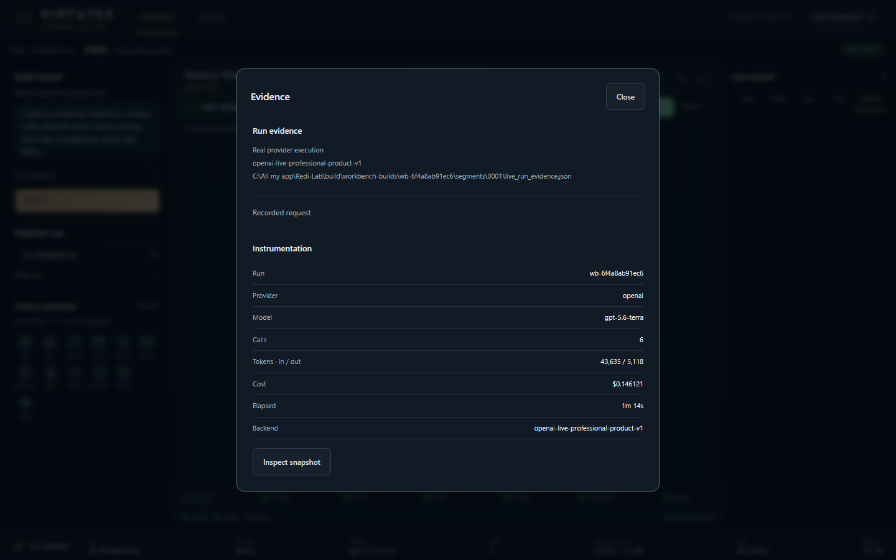
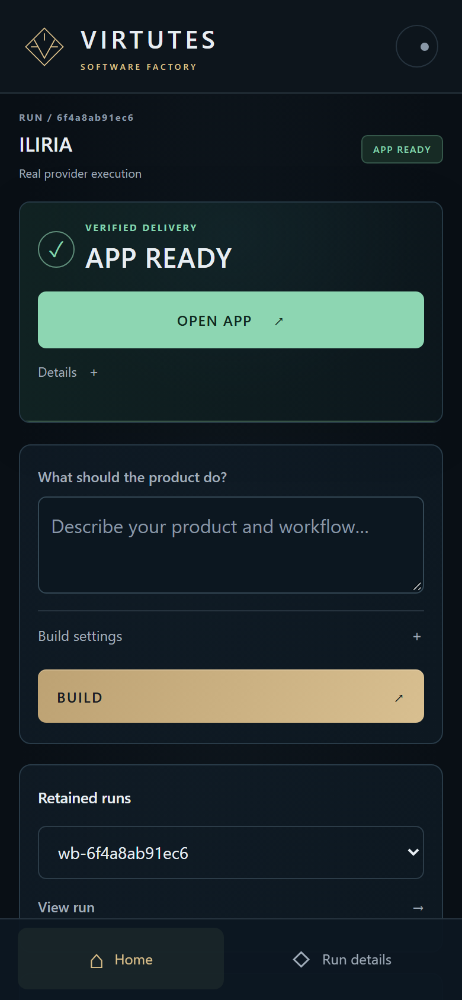
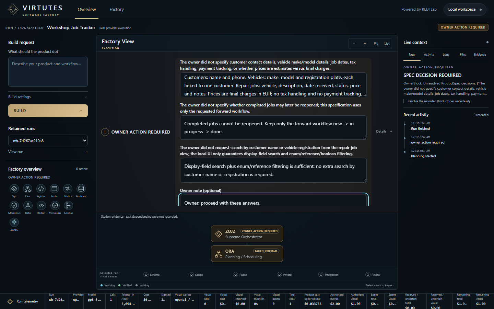
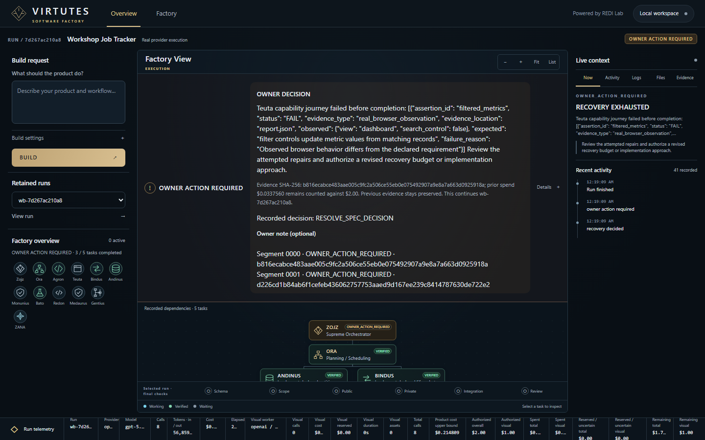

# REDI Lab / VIRTUTES

**An adaptive AI software factory.** REDI Lab treats software delivery like a
production line: fixed, governed **stations** do the work, and the AI models
that staff them are **replaceable workers**. Every step passes explicit quality
gates and leaves evidence that can be replayed and audited later.


## See it work


The demo (full-quality [MP4](docs/media/virtutes-demo.mp4)) opens a retained real-provider build, **ILIRIA**,
in the Workbench. ILIRIA is a creative production board that the Professional product factory built
from one request in 6 model calls, about 49k tokens, USD 0.15 and 1 min 14 s. The demo then
opens the generated app and creates real records. The app enforces its own workflow: new videos
must start in *Idea* and move forward stage by stage.

| Factory view: every station verified | Evidence and instrumentation |
| --- | --- |
|  |  |
| **The generated app with real records** | **Mobile Workbench** |
|  |  |

### Governance in action

Not every run ends in APP READY, and that is by design. In a live build of a car-repair job tracker,
**Ora** stopped planning until the owner settled what the brief left open. Later **Teuta's** UI failed
a real browser check: the dashboard was missing the filter controls the spec required. The line then
tried a same-station correction and a stronger worker. When both failed, it stopped and asked the
owner instead of shipping. The whole run spent USD 0.21 against a USD 2.00 ceiling.

| Owner spec decision | Recovery exhausted, owner action |
| --- | --- |
|  |  |

## Core ideas

- **Stations vs. workers.** A station (spec, build, test, review, visual…)
  defines the contract: inputs, outputs, gates and budget. The worker filling
  it (a model or a deterministic fake) can be swapped without changing the line.
- **Quality gates.** Each hand-off is checked against typed domain contracts
  before the next station may start. Failures stop the line with a recorded
  reason instead of drifting silently.
- **Evidence ledger and replay.** Calls, prompts, outputs, costs and verdicts
  are hashed into an append-only ledger, so a run can be replayed and its
  provenance reconciled.
- **Recipes.** Successful line configurations are stored as recipes and reused
  for warm starts on new work.
- **Minimum Capable Worker (MCW) experiments.** Paired and hold-out experiments
  measure the cheapest worker that still passes a station's gates, under an
  explicit cost ceiling.
- **Governed recovery.** Bounded same-run recovery and correction loops, with
  build budgets and runtime freshness checks.

## VIRTUTES Workbench

A local, dependency-free web Workbench shows the factory as a live task graph.
The crew is presented as personas: **Zojz** and **Ora** (orchestration),
**Agron**, **Teuta**, **Andinus**, **Bindus**, **Redon**, **Bato**,
**Monunius**, **Medaurus**, **Gentius** and **ZANA** (visual station). It works
on desktop and mobile, with budget controls, per-task telemetry and an
"open app" result view.

## Proven results

- A **Mini CRM** built end to end by the factory line.
- A **multi-station parallel live run** across a dependency DAG.
- **952 tests**. On Windows, run them in UTF-8 mode (`PYTHONUTF8=1`); two integration tests depend on it.
- **Zero runtime dependencies**: Python standard library only (Python 3.11+).

## Getting started

```bash
pip install -e .[dev]
pytest
```

Start the Workbench (offline by default, using deterministic fake workers):

```bash
python -m redi_lab.workbench.server --port 8765
# then open http://127.0.0.1:8765/
```

### Live provider calls

Nothing contacts a model provider unless you arm it explicitly. Live runs need:

- your own key in `REDI_OPENAI_API_KEY`
- `REDI_LIVE_PROVIDER=1`
- the `--live` flag on the relevant script, plus its cost ceiling

No keys are included in this repository.

## Repository layout

| Path | Contents |
| --- | --- |
| `redi_lab/` | Domain contracts, factory line, gates, evidence ledger, replay, recipes, experiments, Workbench |
| `tests/` | Unit and integration tests (offline) |
| `scripts/` | Validation and experiment runners |
| `docs/` | Architecture, research charter, threat model, data policy, station designs |
| `experiments/` | Experiment bindings and fixtures |

## License

Source-available for reading and evaluation only. See [LICENSE](LICENSE).
